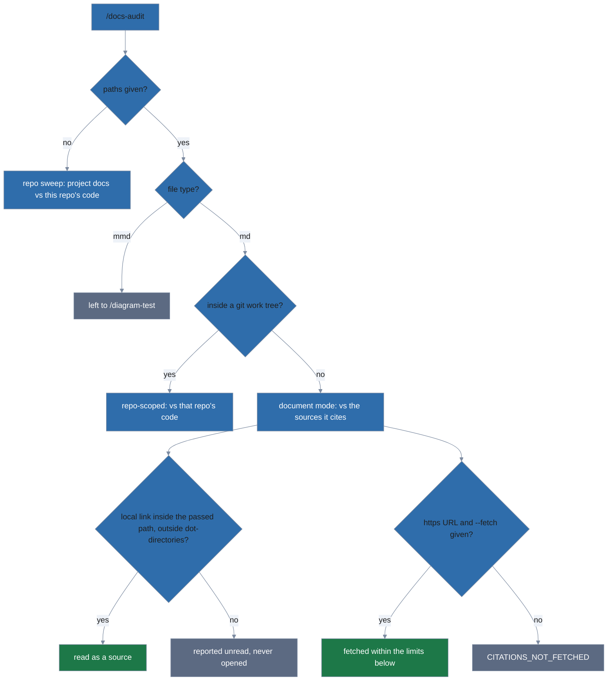

# Getting started

The [README](../../README.md) has the shortest path to a first result. This
page covers the rest of setup and everyday use.

## Requirements

- git
- Node.js 20 or newer
- bash 4 or newer
- `uv`, to install lola (see the README for the install command)
- lola. The install line pins v0.7.0, the version CI tests. The install
  check (`.taskfiles/scripts/verify-lola-module.sh`) accepts lola 0.5.0 or
  newer.

On macOS, the system bash is 3.2, which is not supported. Install a
current one with `brew install bash`, and check that `bash --version`
reports 5.x. If it still reports 3.2, Homebrew's `bin` directory is
behind `/bin` on your `PATH`.

## Bundled dependencies

The docs-organization skill's npm dependencies ship pre-bundled inside the
module, so there is no `npm install`, no network access needed after
`lola install`, and no follow-up step:

- `@aj-archipelago/merval` validates mermaid diagrams
- `markdown-it` parses Markdown docs
- `@asciidoctor/core` parses AsciiDoc docs
- `js-yaml` reads MkDocs and Antora site configs

GitHub Linguist's language data, used by the staleness check, is vendored
the same way.

## Non-interactive install

`lola install` prompts for assistant and scope when you omit them. Scripted,
with `-f` (`--force`) to overwrite an existing install without prompting:

```bash
lola install docs-discipline -a opencode --scope user -f
lola install docs-discipline -a claude-code --scope project -f
```

## Uninstall

Uninstall mirrors the install. Here `-f` skips the confirmation prompt.

1. Uninstall from the scope you installed into — run **one** of:

   ```bash
   lola uninstall docs-discipline -a claude-code --scope user -f
   lola uninstall docs-discipline -a claude-code --scope project -f .
   ```

   For `--scope project`, name the project path (`.` above). Omitting it
   uninstalls from every project-scope installation `lola` knows about, not
   just the one you are standing in.

2. Unregister the module:

   ```bash
   lola mod rm -f docs-discipline
   ```

## Which model to run `/docs-audit` on

`/docs-audit` runs its judgment prompts on the model your session uses, and
picks none itself. Use the most capable model your assistant offers when the
content-drift results matter: a weaker model reports more drift that is not
there (it reads an "e.g." list as complete) and misses real drift. A stronger
model costs more per run. The comparison behind this advice is in
[the architecture notes](../dev/architecture.md#which-model-runs-the-judgment-prompts).

## Auditing a specific document



`/docs-audit` with no arguments sweeps the docs written for people: the
root README and `docs/`, minus anything written for an AI assistant (skills,
slash commands, agent prompts). Name one or more files or directories to
audit exactly those, including what the sweep skips (gitignored files,
dot-directories like `.issue-draft/`, files outside any repository, and
LLM-facing docs); `.mmd` diagram files are left to
`/diagram-test`:

```text
/docs-audit docs/guide.md              # one doc, checked against this repo's code
/docs-audit .issue-draft/                         # a gitignored draft directory in this repo
/docs-audit ~/drafts/proposal.md                  # outside any repo: checked against what it cites
/docs-audit --fetch ~/drafts/proposal.md          # ...including the https URLs it cites
```

A path outside a git repository has no code to compare against, so its
claims are checked against the sources it cites: local files it links, and,
only with `--fetch`, the `https` pages it links.

Without `--fetch`, the audit never touches the network and reports cited
URLs as `CITATIONS_NOT_FETCHED` (unchecked, not clean). With `--fetch`, it
fetches within these limits:

- refuses `http:` URLs, URLs with credentials or non-443 ports, and any
  host that resolves to a private, loopback, link-local, or otherwise
  reserved address
- sends no cookies or credentials
- caps each fetch at 2 MB and 10 seconds per request (each redirect hop
  counts separately), and the whole run at 90 seconds and 50 URLs
- refuses a compressed response body
- reads a fetched page as data only and never follows instructions found
  in it

A draft's links to local files are checked too, but only when the target
lies inside the directory you passed (or the file's own directory, for a
single file), outside any dot-directory. A link elsewhere is reported as
unread and never opened — the audit does not otherwise read a local file a
draft links.
